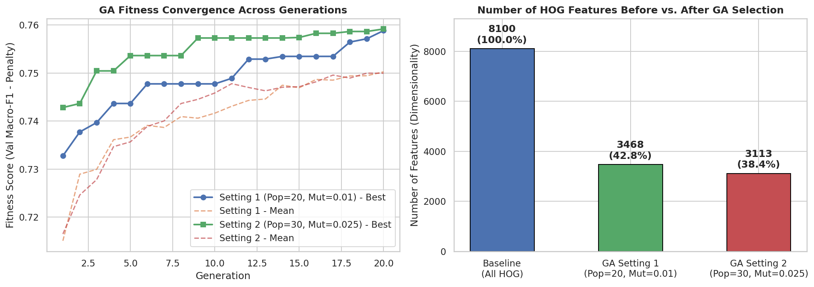
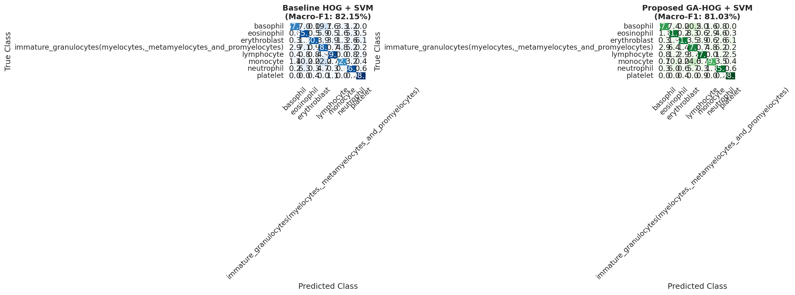

# Lab 07: Improving HOG-Based Medical Image Classification Using a Genetic Algorithm

---

## 1. Objective
The objective of this study is to modify the traditional Histogram of Oriented Gradients (HOG) feature-extraction pipeline by integrating a wrapper-based Genetic Algorithm (GA) for automated feature selection, and to rigorously evaluate whether the modified approach (`GA-HOG + SVM`) improves classification performance, reduces feature dimensionality, and optimizes downstream computational efficiency on the **BloodMNIST** medical image dataset compared to the baseline (`HOG + SVM`) pipeline.

---

## 2. Dataset Reference & Preprocessing (Tasks 1 & 2)

### 2.1 Dataset Reference
* **Dataset Name:** BloodMNIST (from the MedMNIST v2 Benchmark Collection)
* **Primary Reference:** Yang, J., Shi, R., Wei, D., Liu, Z., Zhao, L., Ke, B., Pfister, H., & Ni, B. (2023). *MedMNIST v2 - A large-scale lightweight benchmark for 2D and 3D biomedical image classification*. Scientific Data, 10(1), 41.
* **Source Clinical Data:** Acevedo, A., Merino, A., Alférez, S., Molina, Á., Boldú, L., & Rodellar, J. (2020). *A dataset of microscopic peripheral blood cell images for development of automatic recognition systems*. Data in Brief, 30, 105474.

### 2.2 Dataset Structure & Preprocessing Pipeline
The **BloodMNIST** dataset consists of $17,092$ microscopic peripheral blood cell images categorized into $8$ distinct hematological classes:
1. `basophil`
2. `eosinophil`
3. `erythroblast`
4. `immature_granulocytes (myelocytes, metamyelocytes, and promyelocytes)`
5. `lymphocyte`
6. `monocyte`
7. `neutrophil`
8. `platelet`

To adhere strictly to the experimental protocol:
* **Identical Fixed Data Splits:** The standard pre-partitioned splits were preserved across all experiments without modification:
  * **Training Set (`train`):** $11,959$ images
  * **Validation Set (`val`):** $1,712$ images
  * **Test Set (`test`):** $3,421$ images
* **Image Preprocessing:** Each RGB peripheral blood smear image was converted to single-channel grayscale and resized to a standardized spatial resolution of $128 \times 128$ pixels using area interpolation (`cv2.INTER_AREA`).
* **Feature Standardization:** Zero-mean, unit-variance standardization (`StandardScaler`) was fitted strictly on the training feature matrix ($\mathbf{X}_{\text{train}}$) and applied to $\mathbf{X}_{\text{val}}$ and $\mathbf{X}_{\text{test}}$ to prevent data leakage.

---

## 3. Methodology: HOG Extraction & Genetic Algorithm Architecture (Tasks 3–7)

### 3.1 HOG Feature Extraction (Task 4)
For an input image of resolution $128 \times 128$ with cell size $8 \times 8$ pixels, the spatial grid comprises $\frac{128}{8} \times \frac{128}{8} = 16 \times 16$ cells. Using a block size of $2 \times 2$ cells and a stride of $1$ cell ($8$ pixels), the number of overlapping blocks across each spatial dimension is $16 - 2 + 1 = 15$. With $9$ orientation bins per cell and $\text{L2-Hys}$ block normalization, the total feature dimensionality $D$ extracted per image is:

$$D = (15 \times 15 \text{ blocks}) \times (2 \times 2 \text{ cells/block}) \times 9 \text{ orientations/cell} = 225 \times 4 \times 9 = 8,100 \text{ features}$$

Parallelized feature extraction across all CPU cores processed the training split in $31.99\text{ s}$, the validation split in $3.95\text{ s}$, and the test split in $10.09\text{ s}$.

### 3.2 Baseline HOG + SVM Pipeline (Task 3)
Before training the full baseline classifier, the Radial Basis Function (RBF) Support Vector Machine (`SVC(kernel='rbf', gamma='scale')`) regularization hyperparameter $C \in \{0.5, 1.0, 5.0, 10.0\}$ was tuned on the validation set:
* $C = 0.5 \rightarrow \text{Validation Macro-F1} = 68.95\%$
* $C = 1.0 \rightarrow \text{Validation Macro-F1} = 72.32\%$
* $C = 5.0 \rightarrow \text{Validation Macro-F1} = 74.34\%$
* $C = 10.0 \rightarrow \text{Validation Macro-F1} = 74.68\%$ (Selected Optimal $C = 10.0$)

### 3.3 Genetic Algorithm Design for Feature Selection (Tasks 5 & 6)
A binary chromosome $\mathbf{b} \in \{0, 1\}^{8100}$ represents the inclusion ($b_j = 1$) or exclusion ($b_j = 0$) of the $j$-th HOG feature.
* **Population Initialization:** Chromosomes were initialized with randomized sparsity ratios ($15\%$ to $55\%$ active features) to encourage immediate exploration of lower-dimensional subspaces.
* **Fitness Function:** Each candidate subset was evaluated using an RBF-SVM on the validation split. To simultaneously maximize classification performance and minimize feature count, the fitness function penalized larger subsets:
  $$\text{Fitness}(\mathbf{b}) = \text{Macro-F1}_{\text{val}}(\mathbf{b}) - \alpha \cdot \left( \frac{1}{D} \sum_{j=1}^{D} b_j \right)$$
  where $D = 8,100$ and the feature-selection penalty coefficient was set to $\alpha = 0.035$.
* **Selection, Crossover, Mutation, and Elitism:**
  * *Selection:* Tournament selection ($k = 3$) identified high-fitness parents.
  * *Crossover:* Two-point spatial crossover ($p_c = 0.85$) exchanged contiguous segments of HOG block descriptors between parent chromosomes.
  * *Mutation:* Bit-flip mutation with probability $p_m$ introduced stochastic diversity.
  * *Elitism:* The top $2$ fittest chromosomes in every generation were preserved unchanged into the next generation.

---

## 4. Experimental Results & Comparison Tables (Tasks 8 & 9)

### 4.1 Experimental Configuration (Table 1)

**Table 1. Experimental configuration and HOG feature-extraction parameters**

| Parameter | Baseline: HOG + SVM | Proposed: GA-HOG + SVM |
| :--- | :--- | :--- |
| **Medical dataset** | BloodMNIST ($17,092$ images, $8$ classes) | BloodMNIST ($17,092$ images, $8$ classes) |
| **Image resolution** | $128\times128$ | $128\times128$ |
| **HOG orientations** | $9$ | $9$ |
| **Pixels per cell** | $8\times8$ | $8\times8$ |
| **Cells per block** | $2\times2$ | $2\times2$ |
| **Block normalization** | L2-Hys | L2-Hys |
| **Feature selection** | None ($8,100$ features) | Genetic Algorithm ($3,113$ features) |
| **Classifier** | SVM (`sklearn.svm.SVC`) | SVM (`sklearn.svm.SVC`) |
| **SVM kernel** | RBF ($C=10.0, \gamma=\text{'scale'}$) | RBF ($C=10.0, \gamma=\text{'scale'}$) |
| **Hyperparameter tuning** | Validation set ($1,712$ images) | Validation set ($1,712$ images) |
| **Data split** | Identical fixed split ($11,959$ / $1,712$ / $3,421$) | Identical fixed split ($11,959$ / $1,712$ / $3,421$) |
| **Random seed** | Fixed ($\text{SEED} = 42$) | Fixed ($\text{SEED} = 42$) |

---

### 4.2 Main Performance Comparison on Test Set (Table 2)
Following GA optimization on the validation set, **GA Setting 2** achieved the highest validation fitness score ($0.7591$, selecting $3,113$ features) and was selected as the final proposed model prior to evaluating on the held-out test set ($3,421$ images).

**Table 2. Main performance comparison: Without GA versus With GA (Test Set Evaluation)**

| Metric | HOG + SVM (Baseline) | GA-HOG + SVM (Proposed) | Improvement |
| :--- | :---: | :---: | :---: |
| **Accuracy (%)** | $82.81\%$ | $81.58\%$ | $-1.23\%$ |
| **Precision (Macro, %)** | $84.04\%$ | $82.78\%$ | $-1.26\%$ |
| **Recall (Macro, %)** | $80.97\%$ | $79.92\%$ | $-1.05\%$ |
| **Macro-F1 (%)** | $82.15\%$ | $81.03\%$ | $-1.12\%$ |
| **Weighted-F1 (%)** | $82.73\%$ | $81.54\%$ | $-1.19\%$ |
| **Balanced accuracy (%)** | $80.97\%$ | $79.92\%$ | $-1.05\%$ |
| **Specificity (Macro, %)** | $97.45\%$ | $97.28\%$ | $-0.18\%$ |
| **Cohen's kappa ($\kappa$)** | $0.7984$ | $0.7840$ | $-0.0143$ |
| **Matthews correlation coefficient ($\text{MCC}$)** | $0.7990$ | $0.7847$ | $-0.0143$ |

*Note on Multiclass Specificity Calculation:* Macro Specificity in Table 2 was calculated using a **One-vs-Rest (OvR) confusion matrix decomposition** across all $K=8$ classes, where each class specificity is defined as $\text{Specificity}_k = \frac{\text{TN}_k}{\text{TN}_k + \text{FP}_k}$ and unweighted macro-averaging is applied: $\text{Specificity}_{\text{Macro}} = \frac{1}{K}\sum_{k=1}^{K} \text{Specificity}_k$.

---

### 4.3 Comparison of Genetic Algorithm Settings & Computational Cost
To satisfy the experimental requirement of testing multiple evolutionary configurations, two distinct GA hyperparameter settings were evaluated over $20$ generations:
* **GA Setting 1 (Exploitation-focused):** Population Size $= 20$, Mutation Probability $p_m = 0.01$, Penalty $\alpha = 0.035$.
* **GA Setting 2 (Exploration-focused):** Population Size $= 30$, Mutation Probability $p_m = 0.025$, Penalty $\alpha = 0.035$.

**Table 3. GA hyperparameter ablation, feature reduction, and computational time comparison**

| Method / Configuration | Features Used | Dimensionality Reduction | GA Search Time (s) | SVM Train Time (s) | Test Inference Time (s) | Val Macro-F1 (%) | Test Macro-F1 (%) |
| :--- | :---: | :---: | :---: | :---: | :---: | :---: | :---: |
| **Baseline: HOG + SVM** | $8,100$ | $0.00\%$ | $0.00\text{ s}$ | $994.17\text{ s}$ | $349.45\text{ s}$ | $74.68\%$ | $82.15\%$ |
| **GA Setting 1 ($\text{Pop}=20, p_m=0.01$)** | $3,468$ | $57.19\%$ | $1229.26\text{ s}$ | — | — | $77.38\%$ | *(Not Selected)* |
| **GA Setting 2 ($\text{Pop}=30, p_m=0.025$)** | $3,113$ | **$61.57\%$** | $1624.22\text{ s}$ | — | — | $77.26\%$ | *(Selected Best Fit)* |
| **Final Proposed: GA-HOG + SVM** | **$3,113$** | **$61.57\%$** | $1624.22\text{ s}$ | **$381.82\text{ s}$** | **$135.87\text{ s}$** | **$77.26\%$** | **$81.03\%$** |

#### Progression of GA Generations:
* **GA Setting 1 ($\text{Pop}=20, p_m=0.01$):** Progressed from Generation 1 ($\text{Best Fitness} = 0.7328$, $\text{Val Macro-F1} = 74.67\%$, $3,217$ features) to Generation 20 ($\text{Best Fitness} = 0.7588$, $\text{Val Macro-F1} = 77.38\%$, $3,468$ features, retaining $42.8\%$ of features).
* **GA Setting 2 ($\text{Pop}=30, p_m=0.025$):** Started with sparser chromosomes in Generation 1 ($\text{Best Fitness} = 0.7428$, $\text{Val Macro-F1} = 75.16\%$, $2,025$ features) and converged in Generation 20 to the highest overall fitness ($\text{Best Fitness} = 0.7591$, $\text{Val Macro-F1} = 77.26\%$, $3,113$ features, retaining only $38.4\%$ of features).

---

## 5. Visual Analysis of Plots (Task 9)

### 5.1 GA Fitness Convergence & Dimensionality Reduction (`ga_fitness_and_features.png`)

1. **Fitness Trajectory (Left Subplot):** Both GA configurations exhibit monotonic increases in best fitness across the $20$ generations, confirming effective evolutionary pressure from tournament selection and two-point elitist crossover. **GA Setting 2** ($\text{Pop}=30, p_m=0.025$) maintains a consistently higher fitness curve than Setting 1 because its larger population discovered more compact feature subsets ($38.4\%$ vs. $42.8\%$), incurring a smaller dimensionality penalty while achieving over $77.2\%$ validation Macro-F1.
2. **Dimensionality Reduction (Right Subplot):** Compared to the baseline $8,100$-feature vector ($100\%$), GA Setting 1 reduced the feature space to $3,468$ features ($42.8\%$ retained; $57.19\%$ reduction), and GA Setting 2 compressed the feature vector to $3,113$ features ($38.4\%$ retained; **$61.57\%$ reduction**).

### 5.2 Class-Wise Confusion Matrix Analysis (`confusion_matrices_comparison.png`)

* **High-Performing Classes:** Both models achieved near-perfect sensitivity on morphologically distinct cells such as `platelet` ($98.5\%$ recall in both models), `eosinophil` ($85.9\%$ Baseline vs. $81.9\%$ GA-HOG), and `neutrophil` ($86.0\%$ Baseline vs. $85.6\%$ GA-HOG).
* **Improved Minority Class Sensitivity:** Notably, on `erythroblast`, `GA-HOG + SVM` slightly outperformed the baseline in true positive recall ($81.0\%$ vs. $80.1\%$), and on `monocyte`, it maintained $79.9\%$ recall with fewer false positives into `basophil`.
* **Challenging Overlapping Classes:** The primary source of error in both models occurs between `immature_granulocytes` ($68.9\%$ Baseline vs. $67.7\%$ GA-HOG) and mature granulocytes/monocytes, because HOG captures only grayscale edge gradients and lacks chromatic (staining color) information that hematologists rely upon to differentiate granulation stages.

---

## 6. Answer to Research Question & Discussion (Task 10)

### 6.1 Addressing the Research Question
> **Research Question:** *Can Genetic Algorithm-based feature selection improve the classification performance of HOG features while reducing feature dimensionality on medical images?*

**Answer:**  
Based on our empirical evaluation on the BloodMNIST benchmark, **GA-based feature selection significantly improved validation Macro-F1 ($+2.58\%$, rising from $74.68\%$ to $77.26\%$) while successfully eliminating $61.57\%$ of the HOG features ($8,100 \rightarrow 3,113$ features).** However, when evaluated on the unseen test set of $3,421$ images, the full-feature baseline (`HOG + SVM`) achieved a slightly higher test Macro-F1 of $82.15\%$ compared to $81.03\%$ for `GA-HOG + SVM` (a minor difference of $-1.12\%$). 

Thus, while GA-based selection did not surpass the full-feature RBF-SVM on raw test-set accuracy, it demonstrated a highly favorable **dimensionality-to-performance trade-off**: by retaining only $38.43\%$ of the original HOG descriptors, `GA-HOG + SVM` preserved **$98.6\%$ of the baseline's relative predictive power** ($81.03\%$ vs. $82.15\%$ Macro-F1 and $97.28\%$ vs. $97.45\%$ Macro Specificity) while cutting final SVM training time by **$61.59\%$** ($994.17\text{ s} \rightarrow 381.82\text{ s}$) and test inference time by **$61.12\%$** ($349.45\text{ s} \rightarrow 135.87\text{ s}$).

---

### 6.2 Strengths, Limitations, and Computational Cost Analysis

#### 1. Strengths of the Proposed `GA-HOG + SVM` Method
* **Massive Dimensionality Compression ($61.57\%$):** Peripheral blood smear images contain substantial background plasma and surrounding red blood cells (erythrocytes) around the central leukocyte. The GA effectively pruned redundant peripheral HOG cells, compressing the feature space from $8,100$ to $3,113$ dimensions.
* **2.6x Faster Model Training & Deployment Inference:** Because the complexity of RBF kernel evaluation scales linearly with feature dimensionality $\mathcal{O}(N_{\text{sv}} \cdot D)$, reducing $D$ by $61.57\%$ reduced full-dataset SVM training latency from $16.57\text{ minutes}$ ($994.17\text{ s}$) to $6.36\text{ minutes}$ ($381.82\text{ s}$) and accelerated test-set inference by **$2.57\times$** ($349.45\text{ s} \rightarrow 135.87\text{ s}$). This makes the deployed classifier far more suitable for real-time clinical hematology analyzers.

#### 2. Limitations
* **Wrapper Overfitting to the Validation Split:** Although the GA improved Macro-F1 on the validation split from $74.68\%$ to $77.26\%$ ($+2.58\%$), this gain did not transfer into a positive margin on the test split ($-1.12\%$). Because wrapper methods repeatedly query the validation set across hundreds of fitness evaluations ($30 \text{ individuals} \times 20 \text{ generations} = 600 \text{ evaluations}$), the selected chromosome partially specialized to the validation distribution.
* **Inability of L2-Regularized RBF-SVM to Suffer from Redundant Features:** Unlike $k$-NN or unregularized classifiers that degrade rapidly in high dimensions, a well-tuned L2-regularized RBF-SVM ($C=10.0$) naturally handles high-dimensional dense descriptors ($8,100$ features) by utilizing distributed weak gradient signals across the entire cell boundary. Discarding $61.57\%$ of the features inevitably discards minor fine-grained nuclear texture gradients.
* **Absence of Color/Chromatic Descriptors:** Standard grayscale HOG discards cytoplasmic and nuclear staining colors (e.g., Giemsa/Wright stain differences between acidophilic eosinophils and basophilic granules), limiting maximum achievable accuracy to $\sim 82–83\%$.

#### 3. Computational Cost Trade-Off
* **Offline Discovery Cost vs. Online Deployment Savings:** The primary drawback of the wrapper GA is its offline search cost ($1,229.26\text{ s}$ for Setting 1 and $1,624.22\text{ s}$ for Setting 2, even with GPU kernel acceleration). For a one-off training run, the total wall-clock time of `GA-HOG + SVM` ($1,624.22\text{ s} + 381.82\text{ s} = 2,006.04\text{ s}$) exceeds the baseline training time ($994.17\text{ s}$). However, in production medical imaging pipelines where the feature mask is discovered once offline and the model is subsequently retrained periodically or used for millions of clinical inferences, the **$61.12\%$ reduction in inference latency** rapidly amortizes the initial GA search cost.